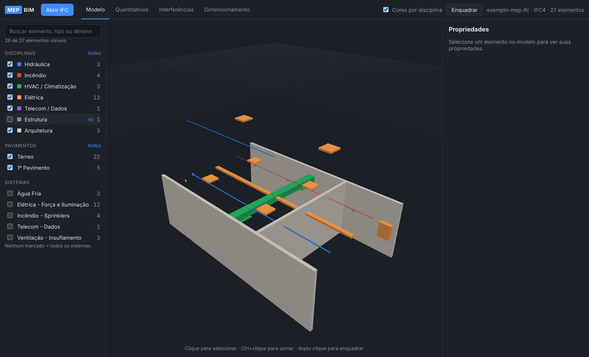
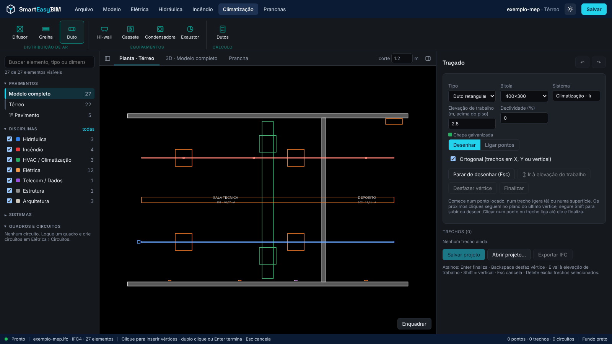
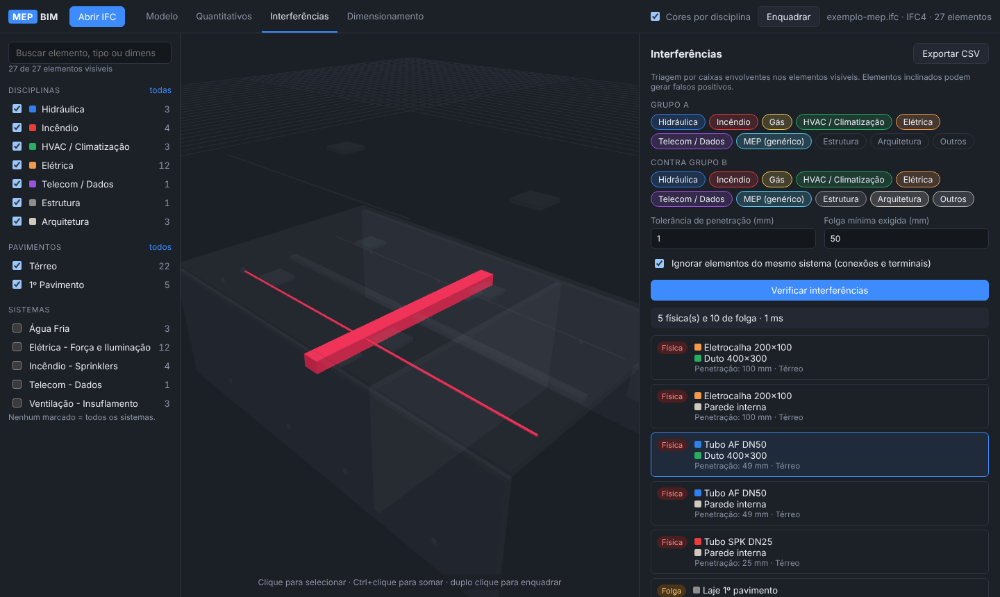
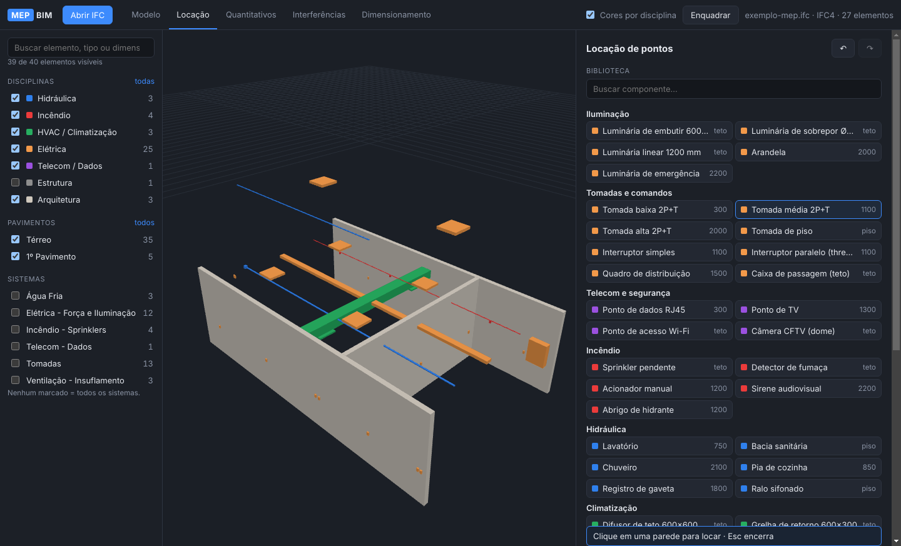

# SmartEasyBIM — aplicativo desktop

Aplicativo **local (desktop)** para projetos de instalações MEP em BIM: hidráulica, incêndio, gás, climatização (HVAC), elétrica e telecom.
Trabalha sobre modelos **IFC** de qualquer software (Revit, Archicad, Tekla, etc.) e **não depende** do app de gestão técnica de projetos que está na raiz deste repositório: são dependências, build e execução separados.



## Interface

- **Menu superior por disciplina**: Arquivo, Modelo, Elétrica, Hidráulica, Incêndio, Climatização e Pranchas.
- **Faixa de ferramentas** logo abaixo, com as funções da disciplina escolhida, em grupos (ex.: Elétrica → Pontos: Tomada, Interruptor, Luminária, Quadro · Telecom · Infraestrutura: Eletroduto, Eletrocalha · Circuitos). Escolher um ponto ou um trecho já abre o editor em planta com o componente pronto para locar.
- **Navegador** à esquerda (pavimentos, disciplinas, sistemas, quadros e circuitos) e **painel da ferramenta** à direita; os dois se ocultam e reaparecem pelos botões nas pontas da barra de vistas.
- **Vistas** no centro: *Planta · pavimento* (edição 2D), *3D* (modelo completo ou pavimento isolado, com cortes) e *Prancha*.
- **Cor de fundo** branco ou preto: botão de sol/lua no cabeçalho ou Arquivo › Fundo. A escolha fica salva.



## O que já faz

| Módulo | Recursos |
| --- | --- |
| **Vistas 3D e cortes** | No navegador (Pavimentos), **Modelo completo** ou um pavimento (isola o pavimento no 3D e enquadra). Em toda vista 3D, a ferramenta **✂ Corte** tem corte horizontal (mostra o que está abaixo da altura escolhida, com atalhos piso + 0,5/1,2/2,5 m) e cortes verticais em X e em Y do projeto, com controle deslizante e inversão de lado. Seleção e locação respeitam o corte. |
| **Visualizador IFC** | Abre IFC2x3 / IFC4 (botão, menu `Ctrl+O`, arrastar e soltar ou duplo clique no arquivo), navegação 3D, seleção (Ctrl+clique soma), duplo clique enquadra, cores por disciplina ou cores originais do IFC. |
| **Locação de pontos** | Biblioteca com 35 componentes (iluminação, tomadas e comandos, quadros, telecom e CFTV, incêndio, louças e ralos, climatização). Clique para locar com encaixe automático na **parede**, no **teto/forro** ou no **piso**, distribuição em **área** (linhas × colunas ou espaçamento máximo), etiquetas automáticas (L1, T1, SPK1…), sistema, circuito e parâmetros. Mover, girar, editar em lote, desfazer/refazer. Salva a locação (`.locacao.json`) e **exporta IFC4** para federar com o modelo. |
| **Filtros** | Por disciplina (com "só" para isolar), pavimento, sistema e busca por nome, tipo ou dimensão. |
| **Propriedades** | Disciplina, tipo, pavimento, sistema, dimensão nominal, comprimento, GlobalId e todos os Psets/Qto do elemento e do seu tipo. |
| **Quantitativos** | Tubos, dutos, eletrodutos e eletrocalhas em metros; conexões, acessórios, terminais e equipamentos em unidades. Agrupa por disciplina, tipo, descrição, dimensão, sistema e pavimento. Clique na linha para selecionar no modelo. Exporta **CSV** compatível com Excel pt-BR. |
| **Traçado** | Tubulações (água fria e quente, esgoto e pluvial com declividade, incêndio, gás), **eletrodutos** (PVC rígido, flexível, aço, dados) e **eletrocalhas**, com bitolas comerciais. Desenho ortogonal clique a clique no plano de trabalho (Shift = vertical), encaixe em pontos locados e em trechos existentes (gera tê), **traçado automático** ligando pontos selecionados a um destino (individual ou em cadeia). Curvas e tês automáticos, etiquetas (ELD-1, AF-2…), circuito, edição de bitola e sistema. |
| **Locação por ambiente** | Usa os ambientes do IFC (`IfcSpace`) com o contorno real: grade alinhada ao ambiente para itens de teto e piso (espaçamento, linhas × colunas, quantidade ou **iluminância pelo método dos lúmens**) e pontos ao longo do **perímetro** para itens de parede, pulando portas e vãos. Cada ponto é fixado na laje, forro ou parede reais. |
| **Circuitos** | Circuitos por **quadro** (sistema 1F, 2F ou 3F com as tensões). Os pontos selecionados são atribuídos ao circuito, e o **quadro de cargas** traz potência, corrente, **comprimento real pelo traçado**, seção (mínima, capacidade de condução da NBR 5410 tab. 36/B1 com FCA, queda de tensão), disjuntor, balanceamento de fases e exportação CSV. Um clique gera o traçado do circuito até o quadro. Os circuitos vão para o IFC como `IfcDistributionCircuit`. |
| **Planta 2D** | Planta por pavimento gerada do **corte real do IFC** (paredes e pilares com hachura, portas e equipamentos em contorno), com a **simbologia** dos pontos locados (elétrica baseada na prática da NBR 5444), trechos (eletroduto contínuo no teto/parede e tracejado no piso, eletrocalha na largura real, subidas e descidas), etiquetas de circuito, potência e bitola, **legenda automática** e **carimbo**. Prancha A0–A4 em escala, exportada em **PDF**, **DXF** (AutoCAD, por camadas) e SVG. |
| **Propriedades (estilo Revit)** | Paleta no topo da coluna esquerda: seletor de tipo (troca o componente ou o tipo de trecho mantendo posição e parâmetros), filtro por categoria na seleção múltipla e grupos **Restrições**, parâmetros da disciplina, **Dimensões**, **Identidade** e **Dados IFC**. Pontos e trechos criados no app são editáveis direto na tabela (vários ao mesmo tempo, com “(vários)” quando os valores diferem); elementos do IFC mostram também todos os Psets. |
| **Tomadas e interruptores** | Cada ponto tem **montagem**: instalação **embutida** (caixa 4×2 até 3 módulos ou 4×4 até 6) ou **aparente** (condulete simples até 3 ou duplo até 6), com **módulos** de tomada 2P+T 10 A/20 A e interruptor simples, paralelo (S3W), intermediário (S4W) e bipolar (S2P, 2 módulos); passa sozinho para 4×4 ao exceder 3 módulos. Na locação e no painel de Propriedades; o aparente sai da parede no 3D. Planta: um triângulo por tomada (pela altura), "20A" marcado, círculo com a sigla dos interruptores (S, S2, S3…) e moldura quando aparente; **legenda por combinação** de módulos, altura e caixa. Quantitativo de caixas, conduletes, placas e módulos; dados no IFC. No programa de necessidades, tomadas acima de 10 A saem como 20 A. |
| **Itens de teto** | Luminárias, difusores, detectores e afins: **alinhados ao forro** (forro do modelo, IfcCovering, ou altura informada), **no entreforro** (fundo do item na altura informada) ou **encostados na laje** superior. |
| **Eletrodutos e caixas de passagem** | Instalação **embutida no piso**, **embutida na laje** ou **aparente no teto** (sob a laje ou no entreforro). Flexível (PVC/PEAD corrugado, curvatura livre) só embutido; rígido (PVC ou aço carbono) com curvas de 45°/90°. Saindo de um ponto, o eletroduto sobe ou desce pela parede até a cota da instalação. **Caixas de passagem** automáticas (15 m sem curva, 12 m com 1, 9 m com 2, máx. 2 curvas; derivações e pontas livres), com tipo pela instalação (octogonal PVC na laje, ferro fundido 4×4" no piso até 1", alvenaria ≥ 30×30×30 cm com matriz de tubos, PVC de sobrepor, condulete até 1" e caixa metálica até 2" no aço) e medida pelas bitolas e afastamentos. Legenda por tipo de eletroduto, instalação e caixa. |
| **Carimbo do empreendimento** | Importação do carimbo padrão em **DXF**, SVG ou PNG/JPG; campos `{{projeto}}`, `{{data}}`, `{{escala}}`… preenchidos em cada folha e campos próprios (`{{cliente}}`, `{{art}}`) informados no painel. Carimbos guardados no computador, com padrão para novas folhas. Exemplo em `samples/carimbo-exemplo.dxf`. |
| **Famílias do Revit** | Plugin **SmartEasyBIM para Revit** (2022 a 2027, pasta [`revit-addin`](revit-addin)): aba *SmartEasyBIM › Exportar famílias* gera um `.sebfam` com geometria 3D, tipos, parâmetros (com unidades) e conectores. No app, *Arquivo › Famílias do Revit* importa o pacote: cada tipo vira item da biblioteca de locação com a geometria real, parâmetros (potência, tensão, fluxo, vazão e os parâmetros próprios da família), classe IFC pela categoria e símbolo de planta. Fixação e lado voltado para o ambiente ajustáveis por família; exportação IFC com a malha (`IfcTriangulatedFaceSet`). Exemplo em `samples/familias-exemplo.sebfam`. |
| **Programa de necessidades** | Aba **Programa**. *Equipamentos (padrão)*: para cada tipo (bacia, lavatório, chuveiro, pia, tanque, máquinas de lavar, geladeira, fogão, forno, micro-ondas, coifa, aquecedor, TV, estação de trabalho, ar-condicionado…) os pontos que ele pede (água fria/quente, esgoto no piso ou na parede, gás, tomadas com potência, dados, TV), com altura, deslocamento e valor, as palavras-chave que o reconhecem no IFC e os **dados técnicos** (potência e tensão → tomada que alimenta o equipamento e quadro de cargas; peso NBR 5626 → pontos de água fria/quente; UHC e Ø NBR 8160 → saída de esgoto). Fica salvo no computador e pode ser exportado para a equipe. *Ambientes*: lista os equipamentos do IFC em cada IfcSpace com o padrão aplicado; dá para reclassificar, desligar, personalizar por equipamento, incluir equipamentos que não estão no modelo, ajustar os dados técnicos de cada equipamento e acrescentar instalações do ambiente; totais por ambiente (Σ potência, Σ pesos com a vazão Q = 0,3·√ΣP e Σ UHC). **Gerar pontos** loca tudo no modelo (na parede mais próxima do equipamento, no piso com afastamento da parede ou pelo contorno), substituindo os gerados antes. O programa é salvo no projeto. Exemplo: *Arquivo › Exemplo apartamento*. |
| **Vínculos IFC** | *Modelo › Vínculos IFC* (ou *Arquivo › Vincular IFC*): sobrepõe ao modelo principal outros IFC (arquitetura, estrutura, luminotécnica…), vários de uma vez, alinhados pelas coordenadas do projeto (as do IFC de cada arquivo). Por vínculo: mostrar/ocultar, disciplina automática (pela classe IFC) ou forçada e transparência no 3D. Os elementos vinculados entram no navegador, filtros, propriedades (com os Psets do arquivo de origem), planta e prancha, cortes, interferências, ambientes (programa e locação por ambiente) e no encaixe dos pontos em paredes e lajes; pavimentos e cotas vêm do principal. O projeto salva a lista e reabre os vínculos pelo caminho (app desktop); se o arquivo mudou de lugar, “localizar…”. |
| **Coordenadas do projeto** | *Modelo › Coordenadas*: lê do IFC principal a origem interna, o **ponto base do projeto** (IfcSite), o **survey point** / coordenadas compartilhadas (IfcMapConversion: E, N, cota, rotação, escala), o **sistema de referência** (IfcProjectedCRS, ex.: EPSG:31983 SIRGAS 2000 / UTM 23S), o **norte verdadeiro** e latitude/longitude; permite informar esses dados quando o IFC não os traz (salvo no projeto) e converter coordenadas projeto ↔ mapa. A barra de status mostra X/Y do projeto e E/N do cursor na planta; as Propriedades, as coordenadas do elemento. Vínculos podem ser posicionados **origem a origem**, por **coordenadas compartilhadas** (survey point de cada arquivo) ou **manualmente**. O IFC exportado grava o mesmo georreferenciamento (IfcMapConversion, IfcProjectedCRS, TrueNorth, lat/long do IfcSite); o DXF da planta pode sair em coordenadas do mapa (UTM, metros) e a prancha traz o norte. No Revit, exporte o IFC4 com “coordenadas compartilhadas” e georreferenciamento para todos os parceiros usarem a mesma referência. |
| **Interferências** | Grupo A × Grupo B por disciplina, tolerância de penetração, **folga mínima** (interferência "de folga"), ignora elementos do mesmo sistema e trechos ligados ao próprio equipamento. Pontos e trechos criados no app são verificados contra a **geometria real** do IFC (caixa orientada × triângulos). Clique para destacar o par e deixar o resto translúcido. Exporta CSV com GlobalIds. |
| **Dimensionamento** | Queda de tensão e seção mínima (NBR 5410), trecho de água fria por pesos/Fair-Whipple-Hsiao (NBR 5626), Hazen-Williams, velocidade e diâmetro equivalente de dutos. Usa comprimento e dimensão do segmento selecionado. |



### Locação de pontos

As ferramentas de locação e traçado abrem a vista **Planta** do pavimento ativo (escolhido no navegador): o corte real do IFC na altura indicada na barra de vistas (padrão 1,20 m), com os pontos, trechos e ambientes desenhados por cima. A aba **3D** continua disponível para quem preferir editar no modelo (combinado com a ferramenta de corte).

1. Escolha um componente da biblioteca e ajuste altura, sistema, circuito e parâmetros.
2. Passe o mouse na planta:
   - **itens de parede** encaixam na face da parede mais próxima, indicada por uma marca ciano com a seta para o ambiente;
   - **itens de teto e piso** usam a cota real da laje ou do forro acima (ou do piso abaixo), obtida por raio no modelo, ou o topo do ambiente se não houver laje.
3. Clique para locar. A pré-visualização fica verde (ou vermelha com o motivo) e o modo continua ativo até `Esc`. Roda do mouse dá zoom, arrastar desloca e duplo clique fora de um modo de edição enquadra.

No **Traçado** em planta, os cliques seguem no plano do último vértice e `E` sobe ou desce até a elevação de trabalho. Clicar num ponto ou trecho liga até ele e finaliza.



Como cada fixação funciona:

| Fixação | Posição |
| --- | --- |
| Parede | Centro na altura informada acima do **piso abaixo** (laje ou revestimento detectados por raio vertical; sem piso modelado, usa a cota do pavimento), alinhado e encostado na face da parede. O arredondamento corre ao longo da parede. |
| Teto / forro | Face superior encostada na face inferior do teto, menos o afastamento. Pertence ao pavimento **abaixo** do teto. |
| Piso | Base sobre o piso, mais o afastamento. |

- **Distribuir em área** (itens de teto e piso): clique em dois cantos. Os pontos ficam no centro das células, por linhas × colunas ou pelo espaçamento máximo, como em sprinklers e luminárias.
- **Atalhos:** `R` gira (teto e piso), `Delete` exclui, `Ctrl+Z`/`Ctrl+Y` desfaz/refaz, `Ctrl+S` salva.
- Os pontos locados entram nos **filtros**, nas **propriedades**, nos **quantitativos** e nas **interferências** junto com os elementos do IFC.
- **Arquivo de locação** (`.locacao.json`): guarda os pontos em coordenadas do projeto IFC. Reabre no lugar certo mesmo que o app desloque a cena de outra forma.
- **Exportar IFC:** gera um IFC4 só com os pontos (mesmos pavimentos e coordenadas do modelo de origem, `IfcDistributionSystem` por sistema e `Pset_MEP_Locacao` com etiqueta, altura, circuito e parâmetros). Abra junto com o modelo original no Revit, Navisworks, Solibri ou BIMcollab para federar.
- Na vista 3D, use **3D por pavimento** e a ferramenta de corte para enxergar dentro dos ambientes. Elementos ocultos ou cortados não recebem cliques.

As alturas padrão da biblioteca são valores usuais de projeto no Brasil, não exigências de norma. Ajuste-as ao padrão do cliente e ao memorial.

### Locação por ambiente

Se o IFC tiver ambientes (`IfcSpace`, os *Rooms* do Revit exportados), o modo **Por ambiente** aparece na aba Locação. Marque os ambientes na lista (há filtro por pavimento) ou clique neles na planta ou na vista 3D. Eles ficam destacados em ciano e a proposta aparece em verde antes de confirmar.

- **Teto e piso** (luminárias, sprinklers, detectores, difusores, ralos…): a grade segue a maior parede do ambiente, com pontos no centro de células iguais (meio espaçamento até a parede), e só ficam os pontos dentro do contorno real e a uma distância mínima das paredes. A distribuição pode ser feita por:
  - espaçamento máximo;
  - linhas × colunas;
  - quantidade por ambiente;
  - para luminárias, **iluminância**: N = E · A / (Φ · Fu · Fm), com o fluxo luminoso do parâmetro da luminária. A tabela mostra a iluminância média resultante.
- **Parede** (tomadas, interruptores, arandelas…): pontos ao longo do perímetro com espaçamento máximo e afastamento dos cantos. Um raio procura a parede atrás de cada ponto; onde não há parede (porta, janela, vão), o ponto é pulado.
- Cada ponto é fixado na superfície real (laje ou forro acima, piso abaixo, face da parede). Pontos já existentes no mesmo lugar não são duplicados.
- Todo ponto, inclusive o locado à mão, guarda o ambiente em que está (parâmetro **Ambiente**, exportado no IFC). A Planta 2D mostra nome, número e área de cada ambiente numa posição livre de instalações.

### Circuitos e quadro de cargas

Na aba **Circuitos**, escolha o quadro (um *Quadro de distribuição* locado) e o sistema de alimentação dele (1F+N 127 V, 1F+N 220 V, 2F+N 127/220 V, 3F+N 127/220 V ou 3F+N 220/380 V).

1. Selecione pontos (Ctrl+clique, lista de pontos ou *Selecionar sem circuito*) e clique em **Novo circuito com a seleção**. O tipo (iluminação, TUG, TUE) é sugerido pelos pontos; nome, descrição, fases (mono, bi, tri), ligação (A, B, C, AB…), fator de potência, FCA e queda máxima são editáveis.
2. **Gerar traçado de Cx até o quadro** cria os eletrodutos em cadeia, já marcados com o circuito.
3. O **quadro de cargas** calcula, para cada circuito:
   - **Potência:** soma dos pontos (VA; em W dividido pelo fator de potência).
   - **Corrente:** pela tensão do quadro (F-N no monofásico, F-F no bi e no trifásico).
   - **Comprimento até o ponto mais distante:** pelo traçado de eletrodutos e eletrocalhas, passando pelos tês. Sem traçado, é estimado e aparece com `*`.
   - **Disjuntor:** a menor corrente nominal ≥ Ib.
   - **Seção:** a maior entre a mínima (1,5 mm² iluminação, 2,5 mm² força), a de capacidade de condução com In ≤ Iz (NBR 5410 tabela 36, método B1, cobre/PVC 70 °C, 30 °C, multiplicada pelo **FCA** de agrupamento e temperatura) e a de queda de tensão. O critério que definiu a seção é indicado.
4. **Balancear fases** distribui os circuitos do mais carregado para o menos carregado. O rodapé mostra a carga e a corrente por fase e o desequilíbrio.
5. **Exportar quadro de cargas (CSV)** gera a tabela para o Excel.

O nome do circuito aparece nas etiquetas da planta, dos pontos e dos trechos (renomear atualiza tudo). No IFC exportado, cada circuito vira um `IfcDistributionCircuit` (ex.: `QD1-C3`) com seus pontos e trechos. Os circuitos são salvos no arquivo de projeto (versão 3).

Valores de capacidade de condução e fatores devem ser conferidos com a edição vigente da NBR 5410 e com os critérios do projeto. Fator de demanda e diagrama unifilar ainda não estão implementados.

### Planta 2D e pranchas

Na aba **Planta 2D**, escolha o pavimento, a altura de corte (padrão 1,20 m acima do piso), a escala e o formato da folha. A prancha aparece no lugar da vista 3D: roda do mouse dá zoom, arrastar desloca, duplo clique enquadra a folha e clique seleciona o elemento, igual às outras abas.

- **Arquitetura e estrutura:** corte horizontal real das malhas do IFC. Paredes e pilares cortados ficam com hachura; portas e demais elementos, em contorno. Tubulações e dutos que já vêm no IFC são cortados na meia altura de cada peça, para mostrar o percurso.
- **Pontos locados:** símbolo em tamanho de papel (constante em qualquer escala). Itens de parede ficam apoiados na face, voltados para o ambiente; luminárias, difusores, quadros e louças mostram também o contorno real. Por convenção, as tomadas são um triângulo vazio (baixa), meio cheio (média) ou cheio (alta).
- **Trechos:** eletroduto contínuo no teto/parede e tracejado quando corre no piso; eletrocalha na largura real; marcas de subida e descida nos verticais que não terminam num ponto; ponto cheio nos tês. Etiqueta com número, bitola, circuito e declividade ao longo do trecho.
- **Textos:** etiquetas, circuitos, potências e bitolas podem ser ligados ou desligados, e todos têm halo branco para ficar legíveis sobre linhas e hachuras.
- **Prancha:** margens da NBR 10068 (25 mm à esquerda). Em A0–A2, legenda e carimbo ficam numa coluna à direita; em A3–A4, numa faixa no rodapé. A legenda é montada só com o que aparece no desenho. O carimbo tem projeto, conteúdo, responsável técnico, escala, data, revisão e folha. O app avisa quando a planta não cabe na folha na escala escolhida.
- **Exportações:**
  - **PDF** no tamanho exato do formato, vetorial e com textos pesquisáveis;
  - **DXF R12** em milímetros na escala real, com camadas por disciplina (`ARQ-CORTE`, `ELE-PONTOS`, `ELE-TRECHOS`, `ELE-TEXTOS`, `HID-…`), símbolos dimensionados para a escala escolhida e acentos preservados;
  - **SVG**.

A simbologia é um ponto de partida: confira com o padrão gráfico do escritório antes de emitir pranchas.

### Traçado de tubulações e eletrodutos

Na aba **Traçado**, escolha o tipo (eletroduto, eletrocalha, água fria…), a bitola, o sistema, o circuito e a **elevação de trabalho** (altura acima do piso em que os trechos horizontais correm, por exemplo logo abaixo da laje ou do forro).

**Desenhar** (clique a clique):
1. Clique em **Desenhar trecho** e no ponto de início: um ponto locado (ex.: o quadro), um trecho existente (vira **tê**) ou uma superfície (o trecho fica apoiado nela).
2. `E` (ou o botão ↕) sobe ou desce até a elevação de trabalho. Os próximos cliques seguem no plano do último vértice; com **Ortogonal** ligado, cada trecho fica em X ou Y do projeto. Segure **Shift** para um trecho vertical.
3. Clicar num ponto locado ou num trecho liga até ele (ortogonalmente) e finaliza. `Enter` ou duplo clique finaliza onde está, `Backspace` desfaz o último vértice e `Esc` cancela.

**Ligar pontos** (automático): selecione os pontos de origem (na aba Locação, na lista ou com Ctrl+clique), escolha o destino no modelo (ex.: quadro ou um trecho) e o modo:
- **Em cadeia:** o destino liga ao ponto mais próximo, que liga ao próximo, e assim por diante. É o caso típico de tomadas no mesmo circuito.
- **Individual:** cada ponto vai direto ao destino.

O traçado proposto aparece em verde antes de gerar. Cada trecho sobe do ponto até a elevação de trabalho, segue em X e depois em Y do projeto e desce ao destino.

- **Curvas** em cada mudança de direção e **tês** quando um trecho termina no meio de outro da mesma rede são criados automaticamente e contados nos quantitativos (por ângulo e bitola).
- **Declividade:** esgoto (2% até DN 75 e 1% a partir de DN 100, NBR 8160) e pluvial (0,5%) vêm com o padrão, que é editável. É aplicada aos trechos horizontais, no sentido do desenho (do primeiro ao último clique).
- Os trechos entram nos quantitativos (metros por tipo e bitola, curvas e tês), nas interferências, no arquivo de projeto (`.locacao.json`, versão 2) e no **IFC exportado** (`IfcPipeSegment`/`IfcCableCarrierSegment` com `Qto_*` de comprimento, conexões `IfcPipeFitting`/`IfcCableCarrierFitting` e `Pset_MEP_Tracado`).
- As conexões com equipamentos usam o **centro** do ponto locado. Dois trechos que chegam ao mesmo equipamento são considerados ligados entre si.

### Como a disciplina é definida

1. Tipos IFC que já definem a disciplina (duto = HVAC, luminária = elétrica, sprinkler = incêndio…).
2. Para tubulações e tipos genéricos (`IfcFlowSegment` do IFC2x3), o **sistema**: o `PredefinedType` do `IfcDistributionSystem` e o nome do sistema (ex.: "Sprinkler", "GLP", "Água gelada", "Esgoto").
3. Sistemas exportados apenas como propriedade ("System Name" / "Nome do sistema", comum no Revit) também são reconhecidos.

Comprimentos vêm das quantidades IFC (`Qto_*`), depois das propriedades e, por último, da maior dimensão da geometria.

## Instalador para Windows

O GitHub Actions gera o instalador `SmartEasyBIM-Setup-<versão>.exe` quando disparado manualmente (Actions › SmartEasyBIM - instalador Windows › Run workflow) (workflow [`mep-bim-desktop.yml`](../../.github/workflows/mep-bim-desktop.yml)). Antes de empacotar, ele roda a verificação de tipos e os testes.

1. No GitHub, abra **Actions → SmartEasyBIM - instalador Windows** e entre na execução mais recente (com ✅).
2. Em **Artifacts**, baixe `SmartEasyBIM-Windows-<n>` (um `.zip` com o `.exe`). O artefato fica disponível por 30 dias.
3. Execute o instalador: ele pergunta a pasta, cria atalhos na área de trabalho e no menu Iniciar e associa arquivos `.ifc` ao app (duplo clique num IFC abre o SmartEasyBIM).

O instalador ainda não é assinado digitalmente. Na primeira execução, o Windows pode mostrar "O Windows protegeu o computador": clique em **Mais informações → Executar assim mesmo**. Para eliminar esse aviso é preciso um certificado de assinatura de código (pode ser configurado depois como segredo do repositório).

A execução também pode ser disparada manualmente pelo botão **Run workflow**, que só aparece depois que o workflow estiver no branch principal.

## Como executar

Requisitos: Node.js 20+.

```bash
cd apps/mep-bim
npm install          # baixa o Electron e prepara o WebAssembly do web-ifc
npm run dev          # abre o app desktop em modo desenvolvimento
```

Outros comandos:

| Comando | Para quê |
| --- | --- |
| `npm test` | Testes do núcleo (cálculos, classificação, quantitativos, interferências) e de leitura do IFC de exemplo |
| `npm run typecheck` | Verificação de tipos TypeScript |
| `npm run dev:web` | Só a interface no navegador (http://localhost:5180), útil para desenvolvimento rápido |
| `npm run build` | Build de produção em `out/` |
| `npm run dist:win` / `dist:mac` / `dist:linux` | Gera o instalador em `release/` (rode no sistema operacional correspondente) |
| `npm run sample` | Regenera `samples/exemplo-mep.ifc` |

O modelo `samples/exemplo-mep.ifc` (botão **Abrir modelo de exemplo**) tem água fria, sprinklers, duto com difusores, eletrocalha, luminárias, tomadas, ponto de dados, quadro e **interferências propositais** para demonstração.

## Estrutura

```
apps/mep-bim/
├── src/
│   ├── core/            # Domínio puro, sem UI e sem IFC (testável)
│   │   ├── disciplines.ts   # Classificação de tipos IFC por disciplina
│   │   ├── quantities.ts    # Comprimento, dimensão nominal e quantitativos
│   │   ├── clash.ts         # Detecção de interferências (sweep and prune + verificação exata)
│   │   ├── obb.ts           # Caixa orientada × triângulos (eixos separadores)
│   │   ├── runs.ts          # Traçado: tipos, bitolas, geometria, curvas, tês, rota automática
│   │   ├── project.ts       # Arquivo de projeto (pontos + trechos)
│   │   ├── plan/            # Planta 2D: corte (section), símbolos, montagem (build), prancha (sheet), DXF
│   │   ├── library.ts       # Biblioteca de componentes para locação
│   │   ├── placement.ts     # Encaixe em parede/teto/piso e distribuição em grade
│   │   ├── points.ts        # Pontos locados, etiquetas e arquivo .locacao.json
│   │   ├── ifcExport.ts     # Exportação de pontos e trechos para IFC4
│   │   ├── math.ts          # Matrizes e conversão cena ⇄ coordenadas do IFC
│   │   └── calc/            # eletrica.ts, hidraulica.ts, hvac.ts
│   ├── ifc/loadIfc.ts   # Leitura do IFC com web-ifc (geometria, pavimentos, sistemas, Psets)
│   ├── main/            # Processo principal do Electron (janela, menus, diálogos, protocolo app://)
│   ├── preload/         # Ponte segura entre Electron e a interface
│   ├── shared/ipc.ts    # Contrato de comunicação main ⇄ renderer
│   └── renderer/        # Interface React + visualizador Three.js (locacao/, tracado/ e planta/ = abas de autoria e desenho)
├── samples/             # Modelo IFC de exemplo
├── scripts/             # Gerador do IFC de exemplo e preparação de assets
└── tests/               # Vitest
```

**Stack:** Electron, React, TypeScript, Three.js, [web-ifc](https://github.com/ThatOpen/engine_web-ifc) (leitura IFC em WebAssembly), electron-vite, Vitest.

**Segurança:** a interface roda com `sandbox` e `contextIsolation`, sem acesso ao Node. Arquivos são lidos e gravados apenas pelo processo principal, via diálogos. Em produção ela é servida pelo protocolo `app://` com CSP. O `'unsafe-eval'` da CSP é exigido pelo web-ifc.

## Limitações conhecidas

- A leitura do IFC roda na thread da interface: modelos muito grandes (centenas de MB) travam a janela durante o carregamento.
- Interferências por caixa envolvente: rápido, mas trechos inclinados ou curvos geram falsos positivos.
- A queda de tensão não substitui a verificação por **capacidade de condução de corrente** (NBR 5410, tabelas 36–39), que ainda não está implementada.
- Traçado: a rota automática é ortogonal e não desvia de obstáculos (as interferências mostram onde ajustar). Ao mudar a bitola, a geometria acompanha, mas a declividade não é recalculada. Redução de bitola entre trechos ainda não gera peça de redução.
- Planta 2D: mostra o que o plano de corte atravessa; elementos abaixo do corte (pisos, bancadas baixas) ainda não são projetados. Ainda não há cotas, e as hachuras grandes vão para o DXF só como contorno.
- Interferências entre dois elementos do próprio IFC continuam só por caixa envolvente.
- Locação: a grade da distribuição em área segue os eixos X/Y do projeto (não gira com ambientes inclinados). Itens de parede ficam sobrepostos à face, não embutidos. O piso de referência só é detectado em lajes e revestimentos modelados.
- `web-ifc-api.js` tem ~6 MB (traz todas as classes do schema IFC). Num app desktop isso não pesa.

## Roadmap

### Fase 2 — robustez e coordenação
- Leitura do IFC em *Web Worker*, com barra de progresso real e janela responsiva.
- Interferência exata por malha (BVH) aplicada sobre a triagem por caixas.
- Gestão de interferências: status (nova, em análise, resolvida), responsável, comentários, histórico entre versões do modelo, exportação **BCF** e relatório com imagens.
- Caixa de corte (*section box*), planos de corte, medição e vistas salvas.
- Federação: vários IFCs abertos juntos (arquitetura + estrutura + cada disciplina MEP).
- Exportação XLSX formatada.

### Fase 3 — locação e autoria MEP
Concluído (etapa 1, locação de pontos):
- ✅ Biblioteca de componentes com fixação em parede, teto ou piso, alturas configuráveis e parâmetros.
- ✅ Locação por clique com pré-visualização, encaixe em superfícies e arredondamento; distribuição em grade.
- ✅ Edição, mover, girar, desfazer/refazer; arquivo de locação; exportação **IFC4** federável.

Concluído (etapa 2, traçado):
- ✅ Tubulações, eletrodutos e eletrocalhas com bitolas comerciais; desenho ortogonal com plano de trabalho e encaixe em pontos e trechos.
- ✅ Traçado automático (individual ou em cadeia) dos pontos até o destino; curvas e tês automáticos; declividade para esgoto e pluvial.
- ✅ Trechos nos quantitativos, nas interferências (verificação exata contra o IFC), no arquivo de projeto e no IFC exportado.

Concluído (etapa 3, planta 2D):
- ✅ Planta por pavimento a partir do corte do IFC, com simbologia, etiquetas, legenda automática e carimbo.
- ✅ Pranchas A0–A4 em escala; exportação PDF, DXF (camadas) e SVG.

Concluído (etapa 4, ambientes e circuitos):
- ✅ Locação por ambiente (`IfcSpace`) pelo contorno real: grade alinhada, método dos lúmens e perímetro com detecção de vãos.
- ✅ Circuitos ligados ao quadro, quadro de cargas com dimensionamento, balanceamento de fases, traçado do circuito e `IfcDistributionCircuit`.

Concluído (etapa 5, edição em planta e vistas):
- ✅ Locação e traçado num editor em planta 2D por pavimento, com encaixe nas faces das paredes e cota real de teto e piso.
- ✅ Vistas 3D por pavimento e cortes horizontal e verticais (X/Y) em todas as vistas 3D.

Próximas etapas:
- Rota automática com **desvio de obstáculos** (busca em grade evitando vigas, pilares e outras redes) e tronco compartilhado entre pontos.
- Edição geométrica de trechos (arrastar vértice, dividir, unir), reduções e pontos de conexão definidos por equipamento.
- Biblioteca editável pelo usuário (tipos próprios, dimensões, alturas e parâmetros do escritório), com importação e exportação.
- Cópia e matriz de pontos, alinhamento, distância a cantos e vãos, cotas.
- Dutos de ar e leitos para cabos no traçado.
- Diagrama unifilar e fatores de demanda no quadro de cargas; quadros alimentando quadros (alimentadores).
- Sistemas e conectividade (portas IFC), verificação de redes desconectadas.
- Planta 2D: cotas, projeção dos elementos abaixo do corte, várias plantas por prancha, simbologia editável pelo escritório e diagrama unifilar e quadro de cargas.

### Fase 4 — dimensionamento integrado ao modelo
- **Elétrica:** quadro de cargas, divisão de circuitos, demanda, capacidade de condução com fatores de agrupamento e temperatura, disjuntores e DR, taxa de ocupação de eletrodutos e queda de tensão acumulada pelo percurso real.
- **Hidráulica:** pesos por aparelho, percurso crítico, pressão disponível × requerida, água quente, esgoto (UHC, NBR 8160) e pluvial (NBR 10844).
- **Incêndio:** cálculo hidráulico de sprinklers (NBR 10897) e hidrantes (NBR 13714).
- **HVAC:** dimensionamento de dutos por igual perda de carga e balanço de vazões por difusor.
- Resultados gravados como propriedades no IFC e memória de cálculo exportável.

### Fase 5 — integração opcional com a gestão técnica
- Enviar quantitativos e status de interferências para o empreendimento/disciplina correspondente no app de gestão, via API, sem acoplar os dois aplicativos.

## Plugin para Revit

O código está em [`revit-addin`](revit-addin) (C#, uma compilação por versão do Revit). O GitHub Actions ([`smarteasybim-revit.yml`](../../.github/workflows/smarteasybim-revit.yml)) compila o Revit 2022 a 2027 e publica o artefato **SmartEasyBIM-Revit-&lt;n&gt;** com `Instalar.bat`, `Desinstalar.bat` e uma pasta por versão. Para compilar localmente: `dotnet build -c Release -p:RevitVersion=2024` (os assemblies da API vêm do NuGet, não é preciso ter o Revit instalado para compilar).
